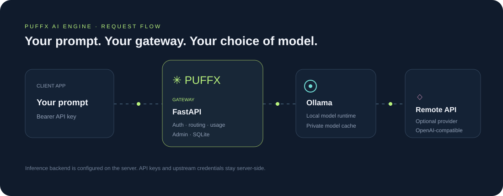

# Puffx AI Engine
### A self-hosted API gateway for local and remote AI models

**Puffx AI Engine gives your application one API address for sending chat prompts to an AI model.** Run the gateway on your own computer or server, then choose where inference happens: on that machine through Ollama, or on a separate OpenAI-compatible inference service. Your app talks to Puffx; Puffx handles client-key authentication, provider routing, and the response.

It is a **gateway**, not an AI model or a hosted chatbot. You bring the model runtime and model weights for local inference, or configure a remote inference service. This separation lets you keep your application integration stable while choosing the inference environment that fits your hardware and privacy needs.

## What Puffx AI Engine includes

| Component | What it does |
|---|---|
| OpenAI-compatible chat API | Gives client applications a familiar chat-completions endpoint and model listing. |
| Ollama provider | Sends prompts to an Ollama runtime you operate, usually on the same computer or in Docker. |
| Remote provider | Forwards supported chat requests to a separately configured OpenAI-compatible inference endpoint. |
| Access control | Accepts a configured client `API_KEY` or generated keys; protects admin routes with `ADMIN_PASSWORD`. |
| Admin dashboard | Shows backend/model status, available models, basic request history, and generated API keys. |
| SQLite storage | Stores generated-key hashes and basic usage records on the gateway host. |

## How a request works

1. Your app sends a chat request to Puffx's `/v1/chat/completions` endpoint with a Puffx bearer key.
2. The gateway checks that key and sends the request to the configured inference backend.
3. Ollama runs the model locally, or the remote provider processes the request on its own infrastructure.
4. Puffx returns the model response to your app and records a basic usage entry.
5. You can inspect service status and request history in the admin dashboard.

The admin password is for operating the gateway; client applications should use their API key. Keep both credentials on trusted server-side systems. Never put a secret key into public browser JavaScript or commit it to Git.

## Choose local or remote inference

| Choice | Where the prompt is processed | What you need |
|---|---|---|
| **Local with Ollama** | On the computer/server running Ollama | Ollama, a compatible model download, and enough memory/disk for that model |
| **Remote provider** | On the separately configured inference server | Network access to that server and its credentials configured on the Puffx server |

In local mode, prompts go to the Ollama runtime you operate. In remote mode, prompts are forwarded to the provider you configure, so that provider's privacy, retention, and usage terms apply. Puffx does not bundle model weights or make those policy decisions for you.

## Who this project is for

- Developers who want an OpenAI-style chat endpoint in front of their own Ollama instance.
- Teams that want to route supported chat requests through a small self-hosted gateway with API keys.
- People who want to try local model serving on Windows or deploy an API gateway on a VPS.

This repository is an early, usable starter—not a fully audited production platform or a managed AI service. It currently focuses on FastAPI, Ollama, remote chat forwarding, SQLite key/usage storage, and an admin dashboard. Review [Current capabilities and limitations](#current-capabilities-and-limitations) and the deployment security notes before exposing it to other users.

## Contents

- [What Puffx AI Engine includes](#what-puffx-ai-engine-includes)
- [How a request works](#how-a-request-works)
- [Choose local or remote inference](#choose-local-or-remote-inference)
- [Who this project is for](#who-this-project-is-for)
- [How it is arranged](#how-it-is-arranged)
- [Choose a deployment mode](#choose-a-deployment-mode)
- [Windows local setup](#windows-local-setup)
- [Linux VPS with Docker Compose](#linux-vps-with-docker-compose)
- [cPanel setup](#cpanel-setup)
- [Configuration reference](#configuration-reference)
- [Use the API](#use-the-api)
- [Admin page and API keys](#admin-page-and-api-keys)
- [Models, downloads, and offline use](#models-downloads-and-offline-use)
- [Operations: logs, backup, upgrade, rollback](#operations-logs-backup-upgrade-rollback)
- [Troubleshooting](#troubleshooting)
- [Tests and validation](#tests-and-validation)
- [Current capabilities and limitations](#current-capabilities-and-limitations)

## How it is arranged

The repository folder is the application root. Run commands from that directory unless the command explicitly changes directory.

```text
puffx-ai-engine/
├── api/                 FastAPI routes, request schemas, authentication
├── core/                Settings, provider selection, key and usage storage
├── providers/            Ollama, remote API, and test-only mock providers
├── dashboard/            Static HTML/CSS/JS admin page served by the API
├── installers/
│   ├── windows/          Windows install/start/stop/update/model scripts
│   ├── linux-vps/        Linux Compose preflight/start script
│   └── cpanel/           Passenger WSGI entry point
├── deploy/
│   ├── docker/           API container definition
│   ├── nginx/            Nginx reverse-proxy example
│   └── systemd/          Optional systemd unit example
├── docs/                 VPS, cPanel, and security notes
├── examples/             PHP, Python, and JavaScript clients
├── tests/                Mock-backed API tests
├── compose.yaml          API + Ollama services and persistent volumes
├── requirements.txt      Python dependencies
└── .env.example          Settings template; copy to an untracked .env
```

The API process and Ollama are separate. The API sends inference requests to Ollama; Ollama owns its model cache. Model weights are not stored in Git. In VPS Compose, the model cache is a named Docker volume. In Windows mode, Ollama stores models in its own user-managed location.




## Choose a deployment mode

| Mode | Where the API runs | Where inference runs | Suitable when |
|---|---|---|---|
| Windows local | Your Windows PC, bound to 127.0.0.1 | Ollama on the same PC | Personal/local use or a local integration |
| Linux VPS Compose | VPS, exposed to the host only on 127.0.0.1:8000 | Ollama container | You can administer a Linux VPS and reverse proxy |
| cPanel native | cPanel Python application runner | Only if the host can run a persistent model runtime | The provider explicitly supports the needed process and resources |
| cPanel gateway | cPanel Python application runner | A separate reachable AI server | Shared hosting cannot run the model itself |

A Windows PC behind a home router is not automatically reachable from the internet. For remote access use a properly authenticated VPN/private network or a secured outbound tunnel; do not publish an unauthenticated Ollama/API port.

## Windows local setup

### 1. Install prerequisites

Install Python **3.11** (the included batch installer invokes `py -3.11`) and Ollama from their official sources. The application needs internet during initial dependency/model download. Once dependencies, runtime files, and the chosen model are installed, inference can run offline.

Open PowerShell and choose a location where you want the code to live, for example:

```powershell
New-Item -ItemType Directory -Force C:\AI
Set-Location C:\AI
git clone https://github.com/puffxhost/puffx-ai-engine.git
Set-Location .\puffx-ai-engine
```

This GitHub repository is private. Your GitHub account must have access to clone it. If you already downloaded the repository ZIP, extract it and open PowerShell in the extracted `puffx-ai-engine` folder instead.

### 2. Install Python dependencies

From the repository root run:

```powershell
.\installers\windows\install.bat
```

This creates a project-local `.venv\` virtual environment, installs `requirements.txt` there, and copies `.env.example` to `.env` if that file does not already exist. It does not change the global Python installation. The script needs the Python Launcher and Python 3.11; if `py -3.11` is not found, install Python 3.11 and enable its launcher.

### 3. Configure credentials and model

Open the project-root `.env` file in a text editor. Set long, unique values for `API_KEY` and `ADMIN_PASSWORD`. Do not paste these secrets into a web page, commit them, or put them in frontend JavaScript.

Download the example model:

```powershell
.\installers\windows\download_model.bat qwen2.5:3b
```

Ollama downloads the model into its own model storage; it is not saved under the Git repository. You may pass another Ollama model name if its format/runtime is supported, for example `.\installers\windows\download_model.bat <model-name>`. Review that model publisher's license and usage terms before downloading.

### 4. Start and check the API

```powershell
.\installers\windows\start.bat
```

The server listens on **127.0.0.1:8000**. Leave that console open while using the API. Stop it with **Ctrl+C**. The `stop.bat` file only prints this instruction; it does not kill processes.

In another PowerShell window:

```powershell
Invoke-RestMethod http://127.0.0.1:8000/health | Format-List
```

Check that `backend` is `ollama` and `model_available` is `True`. A successful HTTP health response alone does not mean the model is loaded; `model_available` comes from Ollama's live model list.

Open the admin page at [http://127.0.0.1:8000/admin/ui/](http://127.0.0.1:8000/admin/ui/). Enter the `ADMIN_PASSWORD` value (not `API_KEY`) as the admin bearer password and select **Connect**. The dashboard then loads backend/model status, available models, request totals, recent activity, and generated keys. The password remains in the current tab and is not saved in local storage. The page is served by the local API; it is not a separate web server.

### 5. Optional: start when Windows starts

The included scripts do not install a Windows service or start automatically on boot. For a persistent server, run it under a service manager you administer and keep the API bound to loopback unless you have deliberately configured a secured reverse proxy. Do not expose port 11434 (Ollama) publicly.

### Windows offline behavior

Offline inference is possible only after the first-time setup is complete and these are present: Python environment/dependencies, Ollama runtime, model weights, and the repository source. Turn off network access only after the model pull and package install have completed. The batch files are installers/launchers, not a standalone executable.

## Linux VPS with Docker Compose

See [the expanded VPS notes](docs/vps.md). The Compose deployment starts two containers: the API and Ollama. It persists the database and model cache in named Docker volumes. The host publishes only `127.0.0.1:8000`; Ollama has no public host port.

### 1. Prepare the server

Use a 64-bit Ubuntu/Debian VPS with Docker Engine and the Compose plugin installed. Check available resources before pulling a model:

```bash
free -h
df -h
uname -m
docker --version
docker compose version
```

Memory and disk requirements depend on model size, quantization, and context length. Leave capacity for the OS, Docker images, model cache, and inference. GPU acceleration is not configured by this Compose file; it requires compatible hardware, drivers, and a matching container runtime.

### 2. Get the private source onto the VPS

Clone over SSH if your GitHub SSH key has repository access, or use your organization's approved private-repository checkout method:

```bash
git clone git@github.com:puffxhost/puffx-ai-engine.git
cd puffx-ai-engine
```

Do not put a personal access token directly into the clone URL or shell history.

### 3. Configure and start

The first installer run creates a protected `.env` and exits so you can configure it before startup:

```bash
chmod +x installers/linux-vps/install.sh
./installers/linux-vps/install.sh
nano .env
```

At minimum set `API_KEY`, `ADMIN_PASSWORD`, and (if needed) `MODEL_NAME`. Save the file with restricted permissions:

```bash
chmod 600 .env
./installers/linux-vps/install.sh
```

The second run validates Compose configuration, builds/starts the containers, pulls the configured Ollama model, and prints service state. The model download can take time and uses disk space. To inspect progress later, run `docker compose logs -f ollama`.

If you prefer manual commands:

```bash
docker compose config
docker compose up -d --build
docker compose exec -T ollama ollama pull qwen2.5:3b
docker compose ps
docker compose logs -f api
```

If you change `MODEL_NAME`, use that same model in the pull command. Verify with `curl -fsS http://127.0.0.1:8000/health`.

### 4. Put HTTPS in front

Do **not** open port 8000 or 11434 to the public internet. Keep the Compose loopback bind, allow inbound 443 at the firewall, and configure Nginx with a valid TLS certificate. `deploy/nginx/puffx.conf` is a starting template: replace `api.example.com`, configure certificate paths, and validate the final Nginx configuration before reload. Use Certbot or your certificate provider to issue and renew certificates. The template does not itself obtain certificates or configure your firewall.

For installation, upgrades, backups, and optional systemd operation see [docs/vps.md](docs/vps.md). Compose already uses `restart: unless-stopped`; systemd is an alternative API process configuration and should not be enabled in parallel with the Compose API on the same port.

## cPanel setup

Read [docs/cpanel.md](docs/cpanel.md) before attempting this. Shared cPanel is often unsuitable for native model inference because it may limit memory, CPU time, background processes, native binaries, or long-running requests.

### Mode A: native inference, only if the host supports it

Ask the hosting provider whether its Python application runner supports Python 3.11+, persistent ASGI/Passenger applications, required packages, writable persistent storage, and enough RAM/CPU/disk for your selected model. Confirm that the host allows Ollama or another compatible runtime to remain running. If any of those requirements are unavailable, the API may start and still fail inference; use gateway mode instead.

If supported:

1. Create a Python application in cPanel and select Python 3.11.
2. Set its application root to the checked-out project directory.
3. Install the packages from `requirements.txt` into the virtual environment cPanel creates.
4. Configure environment variables from `.env.example` in cPanel's application settings; do not expose the `.env` in the web root.
5. Use the supplied `installers/cpanel/passenger_wsgi.py` entry point where the host's Passenger setup supports it.
6. Restart the application using cPanel's supported controls and check `/health`.
7. Test a real inference call; health only confirms that the API can respond.

Do not assume SSH, Docker, root access, daemon permissions, compilation tools, or an unlimited request duration.

### Mode B: cPanel gateway with remote inference

Run the API gateway on cPanel and the model on a separate server reachable over HTTPS. In cPanel's server-side environment settings configure:

- `INFERENCE_BACKEND=remote`
- `REMOTE_INFERENCE_URL=https://your-ai-server.example` (base URL; the gateway appends `/v1/chat/completions`)
- `REMOTE_API_KEY=...` (upstream credential)
- `API_KEY=...` and `ADMIN_PASSWORD=...` for clients/admin access to the cPanel gateway

Restart the app after changing variables. The browser/client sends its Puffx gateway key to cPanel; only the server forwards the upstream credential. The remote AI server must accept requests from cPanel and must itself be secured. Current remote mode forwards chat requests only and buffers streaming responses.

## Configuration reference

Copy `.env.example` to `.env` in the application root for local/Docker deployments, or enter equivalent values in the hosting provider's protected environment settings.

| Setting | Purpose | Notes |
|---|---|---|
| `API_HOST`, `API_PORT` | Intended API bind address and port | Windows launcher currently uses 127.0.0.1:8000; Compose controls container/host binds separately. |
| `API_KEY` | Static bearer key accepted by client routes | Leave blank only if you intend to authenticate exclusively with generated keys. Protect the environment file. |
| `ADMIN_USERNAME` | Reserved setting | Current admin routes do not use a username; admin auth currently compares the bearer token to `ADMIN_PASSWORD`. |
| `ADMIN_PASSWORD` | Protects `/admin/*` routes | Use a unique, high-entropy secret and HTTPS for remote admin access. Empty means admin routes are disabled. |
| `DATABASE_URL` | SQLite database location | SQLite is implemented. PostgreSQL is not currently supported in the code. |
| `INFERENCE_BACKEND` | `ollama`, `remote`, or test-only `mock` | Do not use `mock` for real service. |
| `MODEL_NAME` | Default Ollama model or remote advertised model | Pull it in Ollama first. Compose overrides the Ollama service URL. |
| `MODEL_PATH` | Reserved for future direct model-file provider | Ollama does not read this setting. |
| `OLLAMA_BASE_URL` | Ollama API endpoint | Local default is `http://127.0.0.1:11434`; Compose sets `http://ollama:11434`. |
| `REMOTE_INFERENCE_URL` | Base URL of the upstream OpenAI-compatible API | Remote adapter appends `/v1/chat/completions`. |
| `REMOTE_API_KEY` | Upstream bearer credential | Stored server-side; never put it in browser JavaScript. |
| `RATE_LIMIT` | SlowAPI request limit, e.g. `60/minute` | Currently in-process and IP-based, not a distributed per-key quota. |
| `REQUEST_TIMEOUT` | Upstream inference timeout in seconds | Large/slow models may need a larger value. |
| `MAX_TOKENS` | Maximum accepted output token request | Requests above this value are rejected. |
| `MAX_REQUEST_BYTES` | Maximum HTTP request body size in bytes | Defaults to 1 MiB; oversized requests return 413. |
| `LOG_LEVEL` | Python log level | Avoid logging secrets. |
| `ALLOWED_ORIGINS` | Comma-separated browser origins | Use exact trusted origins; this is not authentication. |

Never commit `.env`. The `.gitignore` excludes it and model/cache/database files by default.

## Use the API

Set a client key on the trusted server making the request. On Windows PowerShell, set the key for the current terminal (replace the placeholder locally; do not paste a real key into a public issue):

```powershell
$env:PUFFX_API_KEY = "your-api-key"
$headers = @{ Authorization = "Bearer $env:PUFFX_API_KEY" }
$body = @{
  model = "qwen2.5:3b"
  messages = @(
    @{ role = "system"; content = "Answer clearly." },
    @{ role = "user"; content = "What is local inference?" }
  )
  temperature = 0.4
  max_tokens = 300
} | ConvertTo-Json -Depth 10
Invoke-RestMethod -Method Post -Uri http://127.0.0.1:8000/v1/chat/completions -Headers $headers -ContentType "application/json" -Body $body
```

Linux/macOS curl example:

```bash
export PUFFX_API_KEY='your-api-key'
curl http://127.0.0.1:8000/v1/chat/completions \
  -H "Authorization: Bearer $PUFFX_API_KEY" \
  -H "Content-Type: application/json" \
  -d '{"model":"qwen2.5:3b","messages":[{"role":"user","content":"Hello"}],"temperature":0.4,"max_tokens":300}'
```

The normal response follows the OpenAI chat-completion shape:

```json
{
  "id": "chatcmpl-<unique-id>",
  "object": "chat.completion",
  "created": 1730000000,
  "model": "qwen2.5:3b",
  "choices": [
    {
      "index": 0,
      "message": {"role": "assistant", "content": "…"},
      "finish_reason": "stop"
    }
  ],
  "usage": {"prompt_tokens": 10, "completion_tokens": 20, "total_tokens": 30}
}
```

Available endpoints:

| Endpoint | Authentication | Behavior |
|---|---|---|
| `GET /health` | None | Reports configured backend and live model discovery. |
| `GET /v1/models` | Client API bearer key | Lists models returned by the active provider. |
| `POST /v1/chat/completions` | Client API bearer key | Validates messages and generation limits, then calls the provider. |
| `GET /admin/status` | Admin bearer password | Reports backend/model and available models. |
| `GET /admin/usage` | Admin bearer password | Returns request count, recent endpoint events, and key metadata. |
| `POST /admin/keys?label=site` | Admin bearer password | Creates a random API key; the secret is returned only in this response. |
| `DELETE /admin/keys/{id}` | Admin bearer password | Revokes a generated key by its displayed ID prefix. |

A missing/bad client key returns 401. Invalid request shapes return 422. Provider failures return 503 with a generic message. Keep keys on trusted servers (PHP/WHMCS backend, Python server, or Node server), not public website JavaScript or mobile app bundles. Working examples are in `examples/php`, `examples/python`, and `examples/javascript`.

## Admin page and API keys

The admin UI is served at `/admin/ui/` by FastAPI. It includes an animated engine illustration, live backend/model/request cards, model discovery, recent usage, and API-key creation. Motion respects the operating system reduced-motion preference. It uses local HTML/CSS/JavaScript assets and no external image or font service. It does not store the admin password in its source files; enter it for the session when you use the page. Use HTTPS for remote access and limit access through your reverse proxy/firewall.

To create a separate key for an application, call `POST /admin/keys?label=application-name` with `Authorization: Bearer <ADMIN_PASSWORD>`. Copy the returned `key` at that time; it is not recoverable later because only its SHA-256 hash is stored. The `id` is safe to use for revocation. Static `API_KEY` is read from protected configuration and is not stored in the keys table.

Usage records are currently basic request counts/timestamps, not billing-grade token accounting. Ollama completion responses report the token counts supplied by Ollama.

## Models, downloads, and offline use

No model files are bundled. Choose a model supported by your inference runtime, download it from a legitimate publisher/source, and read its license. Model licenses differ from this repository's MIT license. Model size alone does not determine RAM needs: quantization, context length, concurrency, and runtime overhead matter. Check free disk space before downloading.

- Windows: use `ollama pull <model>` or the included `download_model.bat`; check installed models with `ollama list`.
- VPS Compose: `docker compose exec ollama ollama list`; pull with `docker compose exec ollama ollama pull <model>`.
- Local Ollama API: `http://127.0.0.1:11434` is internal to the machine/container network. Do not expose it publicly.

## Operations: logs, backup, upgrade, rollback

### Windows

- Start: `installers\windows\start.bat` from the repository.
- Stop: Ctrl+C in the server console.
- Update Python packages: `installers\windows\update.bat`.
- Update source: obtain the new private repository revision, review changes, then update your checkout. Back up `.env` and any local database first.
- The Ollama model store is separate from the project folder; do not delete it if you need offline operation.

### VPS Compose

```bash
docker compose ps
docker compose logs -f api
docker compose logs -f ollama
docker compose restart
```

Back up the `puffx-data` and `ollama-models` volumes plus the protected `.env` file. Keep backups encrypted and off the public web root. Before upgrading, record the current source revision and take a backup. Pull/review the desired revision, rebuild with `docker compose up -d --build`, then check `/health` and a real chat request. Roll back by checking out the previous source revision, rebuilding, and restoring the matching database backup if a migration ever changes the schema. No automatic database migration/rollback system is included currently.

## Troubleshooting

| Symptom | Check / remedy |
|---|---|
| `py -3.11` not found | Install Python 3.11 and its Python Launcher; rerun the installer. |
| Dependency installation fails | Confirm internet access and supported Python; rerun `.venv\Scripts\python -m pip install -r requirements.txt`. Check that security software/proxy is not blocking package downloads. |
| `/health` says `model_available: false` | Start Ollama, run `ollama list`, and pull the exact `MODEL_NAME` configured in `.env`. |
| Chat returns 401 | Check `API_KEY` and the exact `Authorization: Bearer ...` header. For generated keys, ensure it has not been revoked. |
| Chat returns 503 | Check API/Ollama logs, Ollama availability, model name, available RAM/disk, and request timeout. Error responses intentionally do not expose upstream secrets. |
| VPS API container cannot reach Ollama | Check `docker compose ps`, `docker compose logs ollama`, and that `OLLAMA_BASE_URL=http://ollama:11434` is applied by Compose. |
| VPS model download fails | Check outbound network/DNS, free space, and model identifier; retry with `docker compose exec ollama ollama pull <model>`. |
| cPanel app is killed or times out | Ask provider about process, memory, CPU, and execution limits. If persistent inference is not supported, use cPanel gateway mode. |
| Remote gateway returns 503 | Confirm the upstream URL is reachable from the cPanel server, that its path is `/v1/chat/completions`, its credential is correct, and TLS certificate validation succeeds. |
| Admin endpoints return 401 | Set a non-empty `ADMIN_PASSWORD`, restart the API, then send it as a Bearer token. Admin username is not used by the current implementation. |

## Tests and validation

From the repository root:

```bash
python -m pip install -r requirements.txt
python -m pytest -q
python -m compileall -q .
```

Tests use the mock provider and do not download models. A real inference check needs Ollama, a pulled model, and a running API. This repository's previous build environment could not run pytest because its installed pip was broken and the packages were absent; do not interpret the presence of CI configuration as proof that a run passed. Check the GitHub Actions tab for actual run results.

## Current capabilities and limitations

- Ollama local chat and OpenAI-compatible remote chat forwarding are implemented.
- API key authentication supports a configured static key and generated/revocable hashed keys. Admin auth is currently a single bearer password.
- SQLite key/usage storage is implemented. PostgreSQL is not wired.
- `/health` is unauthenticated and returns the provider's currently discovered models.
- Streaming compatibility currently buffers a completed response and emits one SSE content chunk followed by a finish chunk; it is not token-by-token streaming.
- Embeddings are not implemented. `response_format` is accepted by the schema but not guaranteed/enforced by providers.
- Usage history is request-count based and does not persist billing-grade token accounting.
- Rate limiting is process-local and IP-based; it is not a distributed or per-key quota.
- Direct GGUF/llama.cpp integration, model install/unload management, Windows service installation, log rotation, and automated HTTPS provisioning are not implemented.
- `MODEL_PATH` and `ADMIN_USERNAME` are reserved/unused by the current code.
- Review and harden proxy headers, secrets, HTTPS, host firewall, resource limits, and monitoring before exposing the service to the internet.

## 🛟 Support & Contact

Need help or want to report an issue?

- 🌐 Website: [puffxhost.com/contact](https://puffxhost.com/contact)
- 📧 Email: [support@puffxhost.in](mailto:support@puffxhost.in)
- 📞 Call: [+91 8602967573](https://wa.me/918602967573)
- 💬 WhatsApp: [+91 7354336624](https://wa.me/917354336624)

## 📜 License

This project’s app code is licensed under the MIT License. See the [LICENSE](LICENSE) file for full details. Model weights have separate license terms; see the model license section above.

## 🙌 Contributing

Contributions are welcome! Fork the repository, make your changes, and submit a pull request.

## ⭐️ Give a Star

If you found this project useful, please consider giving it a star on GitHub to support its development.

## 🔗 About

Type what picture you want, and this app creates it on your computer with AI. Set it up and download the AI model once while online; after that, you can make pictures without internet.

## 🧠 Developed By

**Nitin Mehta**  
Official site: [puffxhost.com](https://puffxhost.com/)

---

Made with ❤️ by Nitin Mehta.
